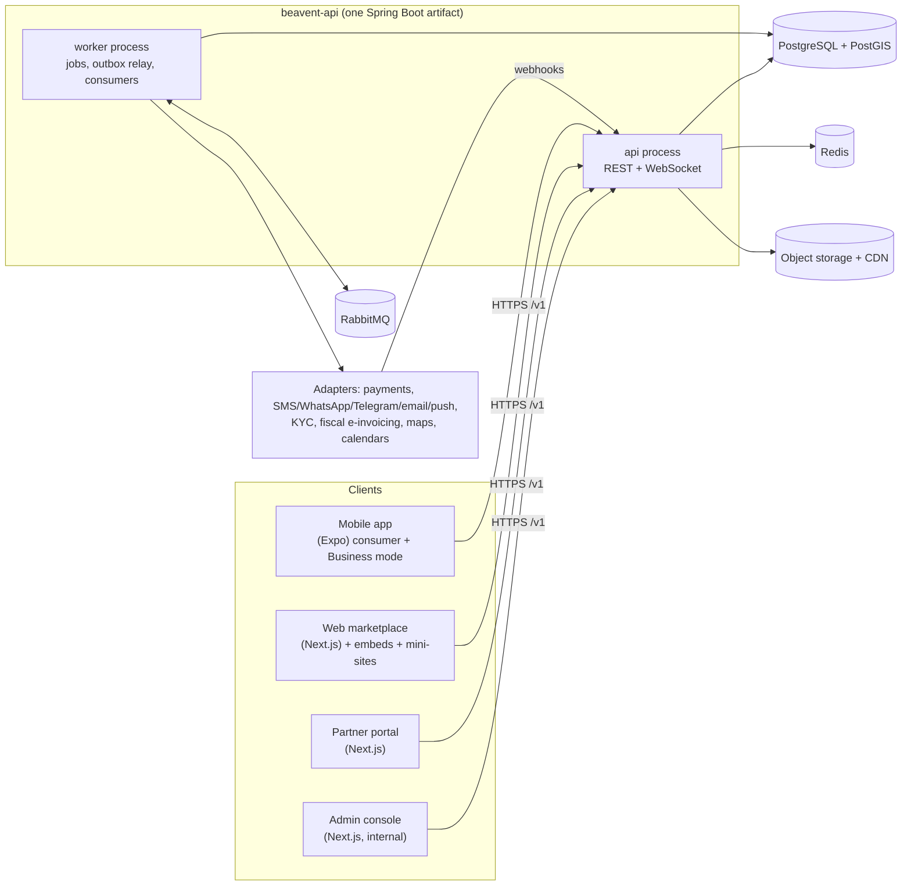

# 03 — System architecture

**Status:** v2 baseline. **Read with:** [01 decisions](01-review-and-decisions.md), [04 payments](04-payments-and-money.md), [05 data model](05-data-model.md), [06 markets](06-markets-and-localization.md).

Beavent (working name) is one platform for **booking services** (salons, barbers, spas, clinics, gyms, freelancers, at-home professionals), the Fresha half, and **running and selling events** (concerts, conferences, workshops, classes, festivals, timed-entry attractions), the Eventbrite half. It launches in Ethiopia, then expands to East Africa and the rest of Africa.

## 1. The five deliverables



| # | Deliverable | Audience | Technology |
|---|---|---|---|
| 1 | **Backend** `beavent-api` (`backend/`) | All clients, providers' webhooks, partner API | Java 25 (LTS), Spring Boot 4, Spring Modulith, jOOQ, Flyway, PostgreSQL 18 + PostGIS, Redis, RabbitMQ |
| 2 | **Mobile app** | Consumers; organization members in Business mode | Expo / React Native, TypeScript, EAS builds + OTA updates |
| 3 | **Web marketplace** | Consumers (SEO discovery, booking, checkout, account), embeddable widgets, organization mini-sites | Next.js (App Router), TypeScript |
| 4 | **Partner portal** | Owners, managers, front desk, event organizers, finance | Next.js, TypeScript |
| 5 | **Admin console** | Platform staff: ops, support, risk, finance, moderation, market managers | Next.js, TypeScript, internal network + SSO + MFA |

Everything lives in one repository; the TypeScript clients are npm workspaces (Turborepo) and share generated API types and design tokens:

```
backend/          Spring Boot (Gradle) — API + worker processes
mobile/           Expo — consumer app + Business mode
web/              Next.js marketplace + /embed
business/         Next.js business / organizer portal ("partner portal" in these docs)
admin-console/    Next.js admin console
packages/
  api-client/     generated from the OpenAPI spec (TS types + fetch client + React Query hooks)
  ui/             design tokens, web components, RN components
  i18n/           ICU message catalogs (am, om, ti, so, en, sw, rw, fr, ar …), formatting
  calendar/       Ethiopian ⇄ Gregorian conversion, Ethiopian local-time formatting
  money/          minor-unit Money type, formatting from currency metadata, cash rounding
db/
  migration/      Flyway SQL (this repo's V1 baseline)
  tests/          invariant tests
  scripts/        validate.sh, concurrency_check.sh
docs/
docker-compose.yml  local PostGIS, Redis, RabbitMQ, MinIO, Mailpit
```

### 1.1 Mobile app (one app, two modes)

One store listing keeps acquisition and support simple: the same person often books a hairdresser and buys a concert ticket, and a stylist is also a consumer. **Business mode** appears only when the signed-in user has an active membership. It is a lazy-loaded bundle and is re-authorised by the backend on every call.

| Consumer mode | Business mode |
|---|---|
| **Discover**: one search across places to book and things to do; map; filters (near me, open now, price, rating, women-only/men-only, at-home, date, category, free events) | **Today**: day timeline across staff; arrivals; unpaid balances; quick actions |
| **Book**: services, variants, add-ons, professional, time; group booking; at-home address and travel fee; deposit or pay at venue | **Calendar**: day/week by staff or resource; drag to move; walk-in; block time; waitlist offers |
| **Tickets**: ticket types, seats, add-ons, promo/access codes, attendee details | **Check-in**: camera scanner, offline manifest, search by name/phone/serial, re-entry, counters by gate |
| **Wallet**: tickets with rotating QR (offline), appointments, gift cards, memberships, package balances | **Checkout/POS**: cart of services/products/tickets, split tender (cash + telebirr + gift card), tips, receipt by SMS/Telegram |
| **Inbox**: chat with businesses and organizers, notifications | **Customers**: profile, notes, alerts, forms, photos, history |
| **Account**: profile, addresses, payment instruments, language, calendar preference, privacy | **Messages**, notifications, sales snapshot, own schedule and clock-in/out |

Field constraints: low-end Android first (Hermes, small bundles, image budgets, list virtualisation); tickets and today's appointments are cached for offline use; push via FCM/APNs with SMS/Telegram fallback for critical messages; deep links for payment returns, ticket transfers and review requests.

### 1.2 Web marketplace

Server-rendered for SEO, localised URLs, and fast on 3G.

| Route | Purpose |
|---|---|
| `/{lang}` | Home: personalised feed, collections, nearby, this weekend |
| `/{lang}/{city}` · `/{lang}/{city}/{category}` | Landing pages (e.g. `/am/addis-ababa/braids`, `/en/addis-ababa/concerts`) |
| `/{lang}/search` | Unified search with map |
| `/{lang}/p/{org}/{location}` | Location page: services menu, team, reviews, hours, map, gallery, book button |
| `/{lang}/p/{org}/{location}/book` | Booking flow |
| `/{lang}/e/{event}` | Event page: dates, ticket types, seating map, organizer, FAQs, reviews |
| `/{lang}/o/{org}` | Organizer/business profile with all events and locations; follow |
| `/{lang}/checkout/{orderId}` | Checkout (payment method selection, push-prompt waiting screen, manual-transfer instructions) |
| `/{lang}/account/*` | Orders, tickets, appointments, gift cards, memberships, saved, settings |
| `/{lang}/c/{collection}` | Curated collections |
| `/embed/book/{org}` · `/embed/tickets/{event}` | Embeddable booking and checkout widgets for partners' own websites and social links |
| Custom domains | `tenant.custom_domains` → middleware rewrites to the org mini-site |

### 1.3 Partner portal

One workspace for every kind of organization. The navigation is driven by `tenant.organization_capabilities` and the member's permissions (`tenant.role_permissions`).

| Area | Capability | Contents |
|---|---|---|
| Home | all | Today, alerts (unpaid deposits, low stock, pending reviews), onboarding checklist (KYB, payout account, first service/event) |
| Calendar & appointments | APPOINTMENTS | Calendar, appointment detail, waitlist, booking policies, online booking settings, resources |
| Events | EVENTS | Event wizard (details, schedule/recurrence/time slots, ticket types, price phases, capacity pools, holds, seating), attendees, check-in devices, box office, waitlist, co-hosts, event analytics |
| Classes | CLASSES | Class series (events of kind `CLASS_SERIES`), instructors, class credits |
| Sales | all | Orders, POS, invoices and quotes, payment links, cash drawers, refunds |
| Customers | all | CRM, tags, segments, forms, consents, imports, merges |
| Catalogue | APPOINTMENTS / RETAIL | Services, variants, stages, add-ons, bundles, pricing levels, products, gift cards, memberships, packages |
| Team | all | Staff, roles and permissions, locations, working patterns, shifts, time off, timesheets, commissions, pay runs, targets |
| Inventory | RETAIL | Stock, movements, purchase orders, suppliers, transfers, stocktakes, delivery zones |
| Marketing | MARKETING | Campaigns (SMS/WhatsApp/Telegram/email/push), automations, promotions and codes, referrals, tracking links, ads, reviews |
| Messages | all | Unified inbox (app, WhatsApp, Telegram, SMS), AI concierge settings |
| Reports | all | Sales, payments, appointments, events, team, customers, inventory, marketing; exports |
| Finance | all | Balance (pending/available/reserve), payouts, payout accounts, fees, platform invoices, statements |
| Settings | all | Organization, legal entities, locations, hours, policies, payments (collection mode, methods), integrations, API keys and webhooks, subscription, verification |

### 1.4 Admin console

Internal only (SSO, MFA, IP allow-list). Every mutating action requires a reason and is written to `platform.audit_log`. Permissions come from `iam.staff_roles` and are scoped by market (`iam.user_staff_roles.market_id`).

| Area | Contents |
|---|---|
| Queues | KYB/KYC review, event pre-publication review (risk-based), content reports, refund escalations, payout approvals and holds, disputes, support cases, data-subject requests |
| Search | Users, organizations, orders, tickets, appointments, payments by any reference (phone, serial, provider reference) |
| Organization 360 | Profile, capabilities, plan, risk profile, balances, payouts, fees, verification, members, audit trail; restrict/suspend/restore |
| Payments | Intents and attempts explorer, webhook inbox and replay, provider health, routes and failover, reconciliation runs and exceptions, manual-transfer verification |
| Markets | Markets, currencies, languages, features, admin areas, holidays, tax rates (with verification flag), fiscal schemes, legal documents, provider capabilities, payment routes, comms providers |
| Commercial | Plans, plan prices, entitlements, fee rules, promotions funded by the platform, ads review |
| Content | Home page, banners, collections, help centre (CMS) |
| Platform | Feature flags, staff roles, audit log viewer, impersonation (time-boxed, partner-consented, read-mostly, fully audited) |

## 2. Backend

### 2.1 Process model

One artifact, two process roles, horizontally scalable and stateless:

* **api**: REST + WebSocket; short transactions only; never calls a provider while holding row locks.
* **worker**: the outbox relay, RabbitMQ consumers, scheduled jobs (hold and reservation expiry, payment polling, reminders, recurrence generation, fund releases, payout runs, reconciliation imports, search projection, usage billing, fiscal submissions). Jobs run on a durable scheduler (Quartz JDBC store or db-scheduler) with leader-safe locking.

### 2.2 Modules (Spring Modulith) ↔ database schemas

Every module owns one schema and exposes a Java API plus domain events. Modulith verification tests fail the build on illegal cross-module dependencies.

| Module | Schema | Responsibilities | Publishes (examples) |
|---|---|---|---|
| reference | `ref` | Countries, currencies, languages, admin areas, markets, categories, tax rates, legal documents | `market.updated` |
| identity | `iam` | Sign-up/in (OTP, password, Google/Apple/Telegram), sessions with rotation, MFA/step-up, consents, devices, staff roles | `user.registered`, `user.merged` |
| tenancy | `tenant` | Organizations, capabilities, legal entities, places, locations, roles, members, invitations, domains | `org.created`, `member.joined` |
| team | `team` | Staff, patterns, shifts, time off, timesheets, compensation, commissions, tips, pay runs | `shift.published` |
| catalog | `catalog` | Services, stages, prices, add-ons, bundles, resources, products, plan definitions, galleries | `service.changed` |
| crm | `crm` | Customers, notes, files, treatment records, patch tests, consents, forms | `customer.merged` |
| events | `events` | Events, occurrences, sessions, ticket types, price phases, buckets, seating, holds, tickets, transfers, check-in | `event.published`, `ticket.issued`, `ticket.checked_in` |
| scheduling | `scheduling` | Availability engine, holds, appointments, reservation ledger, blocks, policies | `appointment.confirmed`, `appointment.completed` |
| commerce | `commerce` | Checkout, orders, pricing/tax engine, promotions/codes, invoices, receipts, cash drawers, waitlists | `order.placed`, `order.paid`, `order.cancelled` |
| retention | `retention` | Gift cards, customer balances, memberships, entitlements, loyalty | `membership.renewal_due` |
| stock | `stock` | Stock, movements, purchasing, transfers, stocktakes, fulfilment | `stock.low` |
| payments | `payments` | Provider adapters, routing, intents/attempts, webhooks, polling, refunds, payouts, disputes, statements | `payment.succeeded`, `refund.succeeded`, `payout.paid` |
| ledger | `ledger` | Postings, balances, scheduled releases | `funds.released` |
| billing | `billing` | Plans, subscriptions, fee assessment, usage, platform invoices | `fee.assessed` |
| fiscal | `fiscal` | E-invoicing / fiscal device adapters | `fiscal.accepted` |
| marketing | `marketing` | Segments, campaigns, automations, referrals, tracking links, ads | `campaign.sent` |
| comms | `comms` | Notification routing, templates, channel adapters, conversations, AI concierge | — |
| discovery | `discovery` | Listings projection, search, reviews, follows, saved items, collections | — |
| trust | `trust` | KYB/KYC, risk profiles, moderation, fraud signals | `org.verified`, `org.restricted` |
| platform | `platform` | Files, outbox, idempotency, audit, flags, settings, API clients, outbound webhooks, integrations, exports, support, CMS | — |

**Rule:** a module never writes another module's tables. Example: on `order.paid`, *events* issues tickets, *scheduling* confirms reservations, *ledger* posts, *billing* assesses fees, *comms* notifies, *fiscal* submits, each idempotently via `platform.processed_messages`.

Exception, for atomicity: the checkout command coordinates *commerce*, *scheduling* and *events* inside one database transaction (reserving inventory/time and creating the order), calling each module's Java API rather than its tables.

### 2.3 Data access and request context

* jOOQ (typed SQL) over JPA: the schema relies on constraints, triggers, ranges and RLS, and explicit SQL keeps behaviour obvious.
* Three connection pools, one per database role (doc 05 §5): `beavent_app` (request handling, RLS enforced), `beavent_identity` (identity module), `beavent_system` (workers, admin backend).
* At the start of every transaction the API calls `platform.set_request_context(user_id, org_id)` (transaction-local). The org id comes from the `X-Org-Id` header **after** the server has checked active membership and the permission the endpoint needs. Clients never assert tenancy.
* Public pages and checkout for organization X run with `org_id = X`. Public reads use `SET TRANSACTION READ ONLY` and return only published fields through DTOs.

### 2.4 API conventions

| Concern | Convention |
|---|---|
| Style | REST/JSON, OpenAPI 3.1 is the source of truth; TS client generated into `packages/api-client` |
| Namespaces | `/v1/auth`, `/v1/me`, `/v1/marketplace/*` (public), `/v1/checkout/*`, `/v1/orgs/{orgId}/*` (partner), `/v1/admin/*`, `/v1/hooks/{provider}` (inbound webhooks), `/v1/partner-api/*` (API keys) |
| Money | `{ "amount_minor": 150000, "currency": "ETB" }`, never floats; formatting is client-side from currency metadata |
| Time | RFC 3339 UTC instants plus the IANA zone of the location/occurrence; the Ethiopian calendar is display-only |
| Idempotency | `Idempotency-Key` header required on every POST that creates orders, payments, refunds, payouts or tickets (`platform.idempotency_keys`) |
| Concurrency | `version` columns + `If-Match` on aggregates (orders, appointments) |
| Pagination | Cursor-based (`?cursor=…&limit=…`) |
| Errors | `application/problem+json` with stable `type` codes (`SOLD_OUT`, `SLOT_TAKEN`, `PAYMENT_PENDING`, `REFUND_EXCEEDS_CAPTURED`) mapped from SQLSTATEs (23P01 → `SLOT_TAKEN`, 23514 on buckets → `SOLD_OUT`) |
| Realtime | WebSocket channels: calendar changes per location, check-in counters per occurrence, payment status per intent, inbox |
| Outbound | Partner webhooks signed with HMAC-SHA256, retried with backoff (`platform.webhook_deliveries`) |
| Rate limits | Redis token buckets per IP, user, org and API key; stricter on OTP, login and on-sale endpoints |

### 2.5 Authentication and authorisation

* Phone-first OTP (SMS, with WhatsApp/Telegram as alternative channels), password optional, Google/Apple/Telegram sign-in. Guests can check out with a phone number; their orders are linked when they verify the same phone (`CLAIM_GUEST_ORDERS` challenge).
* Access tokens: JWT (ES256), 10-minute lifetime, audience per app. Refresh tokens: opaque, hashed, rotated on every use within a family; reuse revokes the family (`iam.sessions.family_id`).
* MFA required for organization owners, members holding sensitive permissions (`iam.permissions.is_sensitive`: payouts, refunds, member management, exports) and all platform staff. Step-up (fresh OTP) before changing a payout account or issuing large refunds.
* Authorisation is evaluated per request: role permissions, then location scope (`tenant.member_locations`), then event scope (`events.staff_assignments`). RLS backs this up at the database layer.

## 3. Key workflows

### 3.1 Appointment booking (marketplace, deposit by mobile money)

1. **Availability** (`GET /v1/marketplace/locations/{id}/availability`): computed from working patterns, shifts, time off, closures, policies (notice, interval), existing `schedule_reservations`, stage templates (staff free during processing), resource requirements, and travel time for at-home bookings. Cached for a few seconds and invalidated on calendar events. It is advisory only.
2. **Hold** (`POST /v1/checkout/appointments`): in one transaction, create a `DRAFT` order with lines, the appointment (`PENDING_PAYMENT`), items and stages, `scheduling.holds`, and `HELD` reservations. The exclusion constraint makes a lost race fail with `SLOT_TAKEN`; the client refreshes availability.
3. **Deposit** per policy snapshot: order → `PENDING_PAYMENT` with `expires_at`; `commerce.payment_schedule` gets DEPOSIT + BALANCE (balance collected `AT_VENUE`).
4. **Pay**: create a payment intent; the router picks a route (doc 04). For telebirr push, the app shows "approve on your phone" while polling the intent over WebSocket.
5. **Confirm** on a verified webhook or poll: the intent succeeds, then one transaction converts the hold (hold reservations `RELEASED`, stage reservations `CONFIRMED`), sets the appointment `CONFIRMED`, the order `CONFIRMED`, and posts to the ledger. Notifications follow via the outbox.
6. **Expiry**: `scheduling.expire_holds()` runs every minute. Late successes after expiry are auto-refunded if the slot is gone, or re-confirmed if it is still free.
7. **Visit**: front desk marks arrived/started/completed, takes the balance at POS (split tender), adds tips and products, and issues the receipt (and fiscal document where required). Completion schedules the fund release and the review request.

### 3.2 Ticket on-sale and checkout

1. **High-demand on-sales** go through a waiting room (Redis queue tokens, bot checks) before checkout is reachable.
2. **Reserve**: create the order and lines, then insert `RESERVE` inventory movements for every applicable bucket (occurrence total, ticket type, pools, sessions) **in bucket-id order**. A full bucket raises 23514 → `SOLD_OUT`. Reserved seats move `AVAILABLE → RESERVED` with a conditional update.
3. **Pay** as in 3.1 (free orders skip payment).
4. **Confirm**: insert `CONFIRM` movements (the unique index and trigger guarantee once-only), issue `events.tickets` (one per unit × admission; the unique key prevents double issuance), seats → `SOLD`, deliver tickets to the app wallet plus SMS/Telegram/email with a short serial, and post to the ledger.
5. **Expiry/cancel**: `RELEASE` movements, which the trigger refuses if already released or confirmed. That is what makes the expiry job and a late webhook safe to race.
6. **Transfers** rotate the credential hash. **Organizer date change** moves whole orders: new movements on the new occurrence, `RETURN` on the old one.
7. **Event cancelled**: bulk job creates refunds per order (method per capability, refund-by-payout fallback), voids tickets, `RETURN` movements, notifications.

### 3.3 Check-in (online and offline)

* Devices register under an event/occurrence scope (`events.checkin_devices`) and download a **signed manifest**: credential hashes + ticket status + seat/type, refreshed incrementally.
* QR = opaque random secret (rotated on transfer). The device hashes it and checks the manifest offline. Online, the server is authoritative.
* Every scan has a device-generated `client_scan_id` (`UNIQUE (device_id, client_scan_id)` makes sync idempotent).
* `events.admissions` has one row per ticket × occurrence × session. The first `ADMITTED` wins at the database. Offline duplicates become `CONFLICT` scans for the door supervisor to review. Re-entry toggles `INSIDE`/`OUTSIDE` when the occurrence allows it.

### 3.4 Money after the sale

Capture posts `PAYMENT_CAPTURED` (doc 04 §7). Fees are assessed (`billing.fee_assessments`). Funds stay `SELLER_PENDING` until the service is delivered (appointment completed, or event ended + risk delay), then `ledger.scheduled_releases` moves them to `SELLER_AVAILABLE`. The payout run creates `payments.payouts` according to `payments.org_settings` and `trust.risk_profiles`.

## 4. Infrastructure

| Component | Choice | Notes |
|---|---|---|
| Database | PostgreSQL 18 + PostGIS (managed), one primary + read replica | PITR, encrypted at rest; replica for reports/BI (`beavent_readonly`) |
| Cache / coordination | Redis | Availability cache, rate limits, waiting-room tokens, WebSocket fan-out, idempotency fast-path. Never the source of truth |
| Messaging | RabbitMQ | Outbox relay → exchanges per domain; quorum queues; DLQs per consumer |
| Object storage | S3-compatible (Cloudflare R2 or AWS S3) + CDN + image resizing | `PUBLIC` vs `PRIVATE` vs `SENSITIVE` buckets; KYC and customer photos never on the CDN |
| Search | PostgreSQL FTS + trigram + PostGIS on `discovery.listings` | Move to OpenSearch only when measured latency or ranking needs it |
| Secrets | Cloud secret manager / Vault | DB stores `*_secret_ref` only |
| Observability | OpenTelemetry traces/metrics/logs → Grafana stack or vendor | Correlation id on every request, job and provider call |
| Delivery | GitHub Actions; container images; IaC (Terraform) | Environments: dev, staging (provider sandboxes), production |
| Hosting | One cloud region close to East Africa at launch; per-country residency only where law requires | See doc 06 |

## 5. Security and privacy

* Target OWASP ASVS Level 2; mobile per OWASP MASVS.
* Least privilege at every layer: API role behind RLS; identity role isolated; system role used only by workers and the audited admin backend (doc 05 §5).
* PII minimisation: raw OTP destinations are stored as HMACs; payout account numbers and provider tokens live in the secret store; KYC files are `SENSITIVE` and served via short-lived, purpose-checked signed URLs with audit.
* Webhooks: raw-body signature verification, timestamp tolerance, constant-time compare, persisted before processing, deduplicated (`payments.webhook_events`). A browser redirect is never proof of payment.
* Fraud and abuse: rate limits, bot checks on on-sales and OTP, velocity rules (`trust.fraud_signals`), payout cooling-off after account changes (72 h default), risk tiers controlling payout delay, reserves and pre-event payouts.
* Privacy rights: access/export/erasure workflows (`platform.data_subject_requests`); erasure anonymises CRM rows (`crm.customers.status = 'ERASED'`) while keeping financial records required by law.
* Backups: daily full + continuous WAL; quarterly restore drills. Targets: RPO ≤ 5 min, RTO ≤ 1 h.

## 6. Service levels (initial targets)

| Journey | Target |
|---|---|
| Marketplace search p95 | < 400 ms server time |
| Availability for one location/day p95 | < 300 ms |
| Checkout reserve p95 | < 250 ms (excluding provider time) |
| Payment confirmation after webhook | < 5 s to ticket/appointment confirmed |
| On-sale burst | 10,000 concurrent queue members, 300 checkouts/s sustained in load test |
| Online scan p95 | < 150 ms; offline scan < 50 ms on device |
| Availability (API) | 99.9 % monthly |

## 7. Testing strategy

| Layer | What | Where |
|---|---|---|
| Database invariants | Double-booking, oversell, release/confirm lifecycle, ticket uniqueness, order arithmetic, refund cap, ledger balance, immutability, tenant isolation as `beavent_app`, 40-session race | `db/tests`, `db/scripts/concurrency_check.sh` (runs today) |
| Architecture | Spring Modulith module-boundary verification | API build |
| Domain | Unit + property tests for pricing, tax, availability, fee rules, Ethiopian calendar | API / packages |
| Contract | OpenAPI-driven contract tests; generated client type-checks in every app | CI |
| Providers | Adapter test kits per provider against sandboxes: success, decline, timeout, duplicate webhook, out-of-order webhook, late success after expiry, partial refund, payout failure | Staging nightly |
| Load | On-sale burst, availability, search, webhook storms | Pre-launch and per release train |
| E2E | Mobile (Maestro/Detox) and web (Playwright) golden paths in am/en | CI |

## 8. Delivery roadmap

| Phase | Scope | Exit criteria |
|---|---|---|
| **P0 Foundation** | Monorepo, CI/CD, environments, this DB baseline as Flyway V1, identity, tenancy, roles, files, outbox, admin console shell | `validate.sh` green in CI on PostGIS; login on all clients; org onboarding with KYB case |
| **P1 Ethiopia launch (Addis Ababa)** (the ordered build steps are in [doc 07](07-implementation-plan.md)) | Appointments (calendar, staff, services, stages, resources, policies, deposits, at-home), events (GA tickets, recurring/time slots, price phases, pools, holds, promo/access codes, check-in incl. offline, box office), commerce/POS, gift cards, payments (Chapa only: telebirr/CBE Birr/M-PESA/cards via Chapa; cash and pay at venue recorded at POS; `PROVIDER_SPLIT` with Chapa subaccounts, no platform payouts), reviews, reminders + SMS/Telegram, marketplace search, partner portal core, mobile app with Business mode | Pilot partners live; provider capabilities verified LIVE incl. refunds; reconciliation clean for 4 weeks; tax rates verified |
| **P2 Growth** | Memberships, packages, loyalty, automations, campaigns incl. WhatsApp, reserved seating, ads/featured, AI concierge beta, team pay, inventory/online store, fiscal e-invoicing (as the MoR schedule requires), partner API and webhooks | Retention and marketing KPIs; fiscal scheme accredited |
| **P3 East Africa** | Kenya, then Uganda, Tanzania, Rwanda: M-Pesa/MTN/Airtel via direct or aggregator adapters, Swahili/Kinyarwanda, eTIMS/EFRIS/VFD/EBM adapters | Market activation checklist (doc 06) passed per country |
| **P4 Pan-Africa** | West/North/Southern Africa, Arabic RTL, `PLATFORM_COLLECTS` where licensed, multi-region | Per-country licensing and residency decisions executed |
