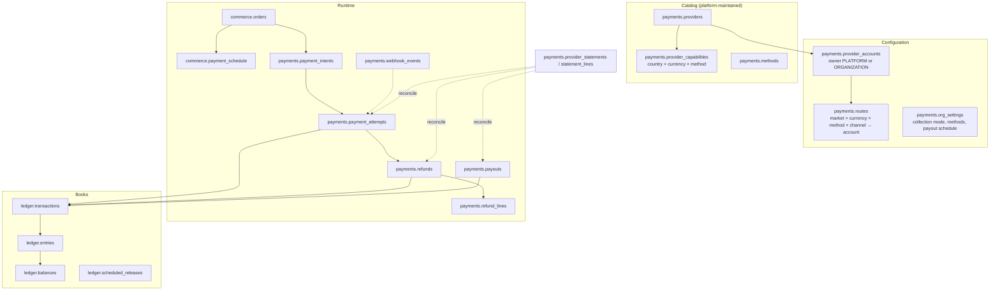
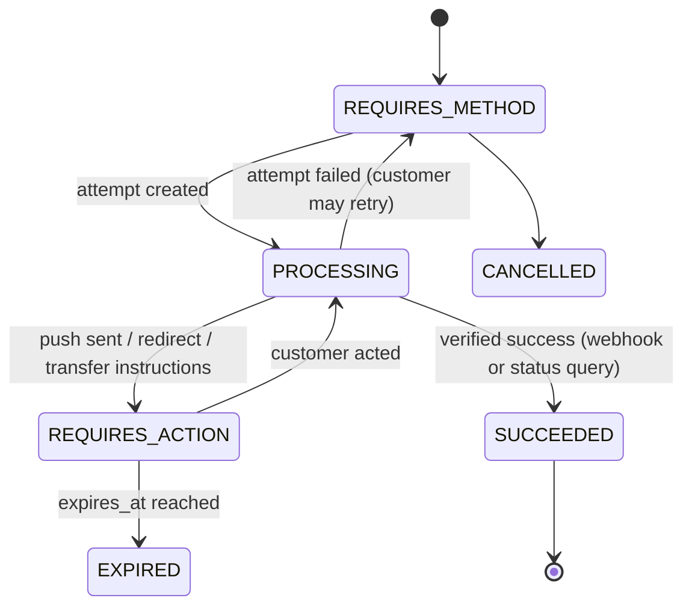

# 04 — Payments and money (provider-agnostic, Africa-first)

**Status:** v2 baseline. **Schema:** [`V1_12__payments.sql`](../db/migration/V1_12__payments.sql), [`V1_13__ledger.sql`](../db/migration/V1_13__ledger.sql), [`V1_14__billing_and_fees.sql`](../db/migration/V1_14__billing_and_fees.sql), `commerce.orders`/`payment_schedule` in [`V1_08__commerce.sql`](../db/migration/V1_08__commerce.sql).

## 1. Goals

1. **Provider-agnostic.** Adding Chapa, telebirr, M-PESA, MTN MoMo, pawaPay, Flutterwave, Paystack, a bank, or a new fiscal or KYC provider means writing an adapter and inserting configuration rows. Product modules (appointments, events, retail) never know which provider was used.
2. **Built for how Africa pays.** Mobile money with push prompts (USSD/STK) that confirm asynchronously, bank apps, manual bank transfers with proof of payment, cash, pay-at-venue, and cards where available. Expect slow and duplicated webhooks, providers that cannot refund through an API, and outages that need failover.
3. **Legally explicit.** Every payment records *who collects the money* (collection mode). The platform can launch without holding customer funds and switch to holding them only where licensed.
4. **Exact and auditable.** Integer minor units, one double-entry ledger, immutable postings, daily reconciliation against provider statements, and invariants enforced in the database (tested in `db/tests/02_money_invariants.sql`).

## 2. Model at a glance



| Concept | Meaning |
|---|---|
| **Provider** | A company/API we integrate with (`CHAPA`, `TELEBIRR`, `MPESA_KE`, `PAWAPAY` …), plus internal providers `CASH`, `INTERNAL` (gift cards, store credit, package credit) and `MANUAL_BANK`. |
| **Method** | What the payer uses (`TELEBIRR`, `CBE_BIRR`, `MPESA`, `MTN_MOMO`, `CARD`, `BANK_APP`, `BANK_TRANSFER`, `CASH`, `GIFT_CARD` …). One method can be reachable through several providers. |
| **Capability** | Whether provider P can do method M in country C and currency X, how the customer interacts (`REDIRECT`, `PUSH_PROMPT`, `QR`, `OTP`, `USSD_DIAL`, `CARD_FORM`, `MANUAL_REFERENCE`, `IN_PERSON`), how confirmation arrives (`WEBHOOK`, `POLL`, `WEBHOOK_AND_POLL`, `SYNC`, `MANUAL`), and whether refunds, partial refunds, payouts, splits, tokenisation and pre-auth are supported. `LIVE` requires `verified_at` (DB CHECK). |
| **Provider account** | Credentials (by secret reference) for one provider in one market and environment, owned by the **platform** or by an **organization**; for split-settlement a seller **sub-account** under the platform's master account. |
| **Route** | Market × currency × method × channel → provider account, with priority, weight and amount limits; an org-specific route overrides platform routes. |
| **Intent** | "Collect this amount for this purpose" (an order, a deposit in the payment schedule, a customer invoice, a payment link, a membership renewal, a no-show fee, a platform invoice). |
| **Attempt** | One try with one provider/method. An intent may have many attempts; **at most one can be `SUCCEEDED`** (unique partial index). |

## 3. Collection modes: who holds the money

Set per organization and market in `payments.org_settings.collection_mode`, snapshotted on every intent.

| | `SELLER_DIRECT` | `PROVIDER_SPLIT` | `PLATFORM_COLLECTS` |
|---|---|---|---|
| Merchant of record at the PSP | Seller (own merchant account; `provider_accounts.owner = ORGANIZATION`) | Seller sub-account under platform master account | Platform (or its licensed partner) |
| Where customer money lands | Seller's settlement account | Split at source: seller share → seller; platform fee → platform | Platform's settlement account |
| Platform fees collected by | Monthly platform invoice (auto-charge or manual) | The split itself | Netting before payout |
| Payouts by platform | None | None (PSP settles seller) | Yes (`payments.payouts`) |
| Refund funding | Seller's PSP balance | PSP reverses split (provider-specific) | Platform clearing; recovered from seller balance |
| Platform holds customer funds | **No** | **No** | **Yes**: needs licence or licensed partner |
| Platform ledger records | Fees receivable / revenue (memo of the sale) | Platform fee share | Full flow: clearing, seller balances, payouts |
| When to use | Larger sellers with their own PSP contract; markets where splits aren't available | **Default target for Ethiopia launch** if the chosen PSP's split/sub-account feature is confirmed | Markets where the platform holds a licence or partners with a licensed institution; needed for instant payouts and cross-seller features |

**Decision for Ethiopia (19 Nov 2026):** every seller uses `PROVIDER_SPLIT` through **Chapa** subaccounts, and Chapa is the only provider for now. Chapa debits refunds and chargebacks from the *platform's* Chapa balance even though the seller was already paid, so the platform keeps a refund float and records a `SELLER_RECEIVABLE`, recovered by topping up the split on the seller's next transactions (capped by `payments.org_settings.recovery_cap_bps`) or by invoice. Exposure is capped per seller (`trust.risk_profiles.max_outstanding_receivable_minor`). See [07 §1 and §3](07-implementation-plan.md#3-money-rules-under-chapa-holds-the-money).

Ethiopia context: payment instrument issuers and system operators are licensed by the National Bank of Ethiopia (2023 directive, amended by ONPS/10/2025, which adds ownership caps and wallet interoperability through a licensed switch) ([NBE](https://nbe.gov.et/nbe_news/the-national-bank-of-ethiopia-has-issued-a-revised-directive-for-mobile-money-providers-to-promote-safety-competition-and-innovation/), [Addis Insight](https://addisinsight.net/2025/05/27/national-bank-of-ethiopia-issues-new-directive-to-strengthen-digital-payment-ecosystem/)). Holding customer funds and paying third parties is exactly the activity these rules govern, which is why `PLATFORM_COLLECTS` stays disabled in the seeded `ET` market (`ref.market_features: PLATFORM_COLLECTION = DISABLED`) until legal sign-off. **This document is not legal advice; confirm with Ethiopian counsel.**

## 4. The adapter contract

Every provider implements one interface in the `payments` module. Adapters are stateless and translate provider vocabularies into the platform's normalised states and failure codes.

```java
public interface PaymentProviderAdapter {
  String providerCode();                                  // "CHAPA"

  // Collection
  CollectionResult createCollection(CollectionRequest r);  // returns next_action: redirect URL, push sent, QR payload, USSD string, instructions
  StatusResult queryCollection(ProviderAccount a, String providerReference);
  void cancelCollection(ProviderAccount a, String providerReference);          // best effort; many rails can't cancel a push

  // Webhooks
  WebhookVerification verifyWebhook(ProviderAccount a, byte[] rawBody, Map<String,String> headers);
  List<NormalizedEvent> parseWebhook(byte[] rawBody);                          // may contain several events

  // Refunds
  RefundResult refund(RefundRequest r);                    // only if capability.can_refund_api, else UnsupportedOperation
  StatusResult queryRefund(ProviderAccount a, String providerReference);

  // Payouts (seller settlement, refund-by-payout, staff pay)
  NameEnquiryResult verifyPayoutDestination(PayoutDestination d);              // bank/MNO name enquiry where available
  PayoutResult createPayout(PayoutRequest r);
  StatusResult queryPayout(ProviderAccount a, String providerReference);

  // Sub-accounts for PROVIDER_SPLIT
  SubAccountResult createSubAccount(SubAccountRequest r);

  // Reconciliation
  Statement fetchStatement(ProviderAccount a, LocalDate from, LocalDate to);    // API/SFTP; else statements are uploaded in the admin console
}
```

Normalised attempt states: `CREATED → AWAITING_CUSTOMER → PROCESSING → SUCCEEDED | FAILED | CANCELLED | EXPIRED | UNKNOWN`, plus `AWAITING_VERIFICATION` (manual transfers) and `SUCCEEDED_DUPLICATE`. Normalised failure codes include `INSUFFICIENT_FUNDS`, `CUSTOMER_DECLINED`, `CUSTOMER_TIMEOUT`, `LIMIT_EXCEEDED`, `INVALID_ACCOUNT`, `PROVIDER_UNAVAILABLE`, `RISK_DECLINED` and `UNKNOWN_ERROR`. Raw provider statuses are kept in `provider_status_raw` for support.

Every outbound call carries an idempotency key derived from the attempt/refund/payout id (`payment_attempts.idempotency_key` etc.), so a retried request can never charge or pay twice on providers that honour it. For providers that don't, the adapter queries by our reference before retrying.

## 5. Routing and failover

```text
choose_route(market, currency, method, channel, amount, org):
  candidates = routes where market, currency, method match
               and channel in (channel, 'ANY') and is_active
               and (org_id = org or org_id is null)
               and amount within [min_amount, max_amount]
               and account.status = ACTIVE and account.health != DOWN
               and capability(provider, country, currency, method).status = LIVE   -- SANDBOX in staging
  if any org-specific candidates: keep only those          -- seller's own account wins (SELLER_DIRECT)
  keep candidates compatible with the org's collection mode
      (SELLER_DIRECT → org-owned accounts; PROVIDER_SPLIT → platform master with org sub-account; PLATFORM_COLLECTS → platform accounts)
  order by priority, then weighted random by traffic_weight
  return first
```

Failover rules, written so a customer is never charged twice:

* **Before customer interaction** (create call fails, times out, returns 5xx): move to the next route immediately within the same intent.
* **After a push prompt was sent** (`AWAITING_CUSTOMER`): **never** automatically start another attempt. The customer may still approve. Only an explicit "try another method" action starts a new attempt; the previous one is cancelled where the rail allows it.
* **Late success** of an abandoned attempt: if the intent is already satisfied, the attempt is stored as `SUCCEEDED_DUPLICATE` (the unique index blocks a second `SUCCEEDED`) and an automatic `DUPLICATE_PAYMENT` refund is created.
* Provider health is fed by error rates and latency from the last N minutes (`provider_accounts.health`). `DOWN` removes the route automatically; ops can override in the admin console.

## 6. Collection flows

### 6.1 Intent and attempt lifecycle



A browser redirect or an app callback is **never** proof of payment. Only a verified webhook, a server-side status query, a verified manual transfer, or an internal tender marks an attempt `SUCCEEDED`.

### 6.2 By interaction type

| Interaction | Typical rails | Flow | Confirmation |
|---|---|---|---|
| `PUSH_PROMPT` | telebirr, M-PESA (STK), MTN MoMo, Airtel Money | Collect phone number (pre-filled from profile) → provider sends PIN prompt to the handset → app shows a waiting screen with a countdown and "didn't get it?" help | Webhook + polling: 5 s, 10 s, 15 s, 30 s, 60 s, then every 60 s until `expires_at` (default 10 min), then one last status query. Still unknown → `UNKNOWN`, resolved by statement reconciliation |
| `REDIRECT` | Chapa/SantimPay/Flutterwave hosted checkout (wallets, bank apps, cards) | Create session → redirect/web-view → return URL shows "checking payment…" | Webhook + status query on return |
| `QR` | Interoperable QR, wallet QR | Show QR at POS or on screen | Webhook / poll |
| `CARD_FORM` / `IN_APP_SDK` | Cards via hosted fields (PCI SAQ-A) | Tokenised by provider; 3-DS as required | Webhook |
| `USSD_DIAL` | Bank USSD | Show `*xyz*ref#` string and reference | Webhook / poll |
| `MANUAL_REFERENCE` | Bank transfer (very common for larger amounts and corporate buyers) | Show account details + unique reference; buyer uploads proof (`proof_file_id`) → attempt `AWAITING_VERIFICATION`; inventory stays reserved for a configurable longer window (e.g. 24 h for invoices) | Seller or finance verifies against the bank statement (`verified_by`, `verified_at`, DB CHECK); statement import auto-matches by reference |
| `IN_PERSON` | Cash at front desk / box office | Requires an open cash drawer session (`cash_session_id`, DB CHECK) | Immediate; `commerce.cash_movements` row |
| `INTERNAL` | Gift card, store credit, package credit | Tender against `retention.*` balances; triggers keep balances ≥ 0 | Immediate |

### 6.3 Deposits, balances, pay-at-venue and no-shows

Card-on-file no-show protection (Fresha's model) does not work where most customers pay by mobile money. The design uses **deposits** instead:

* `scheduling.booking_policies` sets deposit mode (none / percent / fixed / full), which customers it applies to (everyone, new customers, marketplace customers, flagged customers), cancellation window, and late-cancel/no-show fee percentages. The applicable terms are snapshotted on the appointment (`policy_snapshot`).
* `commerce.payment_schedule` holds the plan: `DEPOSIT` (online, now) + `BALANCE` (`AT_VENUE`). Each schedule row is paid by its own intent; the order's `paid_minor` and `payment_status` are kept in sync by trigger.
* No-show: the deposit is `FORFEITED` up to the policy fee; any excess is refunded. Pay-at-venue bookings with no deposit just lose the slot. Repeat no-shows flag the customer, so deposits apply to them next time.

### 6.4 Payment links and renewals

`payments.payment_links` point at an intent and can be sent by SMS, WhatsApp, Telegram or email, for balances, invoices, phone bookings and AI-concierge bookings. Membership renewals use a saved instrument where the provider supports tokens (`payments.instruments`); otherwise the renewal job sends a push prompt or payment link (`retention.customer_memberships.renewal_method`).

## 7. Webhooks, polling and idempotency

1. `POST /v1/hooks/{provider}` reads the **raw body**, resolves the provider account (path segment or payload), verifies the signature (constant-time compare, timestamp tolerance), and **inserts** into `payments.webhook_events` before anything else. The unique key `(provider_code, provider_account_id, dedupe_key)` swallows replays; `dedupe_key` is the provider event id, or a hash of the canonical payload when the provider has none. Respond 2xx fast.
2. A worker processes `RECEIVED` rows: parse → for each normalised event, lock the attempt (`SELECT … FOR UPDATE`), apply the state transition only if it moves forward, and write the domain changes + outbox in the same transaction.
3. Out-of-order events are harmless: transitions are monotonic, and a `SUCCEEDED` after `EXPIRED` takes the late-success path (§5).
4. Polling covers missing webhooks (`payment_attempts.next_poll_at`, `poll_count`). Polling and webhooks run through the same transition function.

## 8. Refunds

| Step | Rule |
|---|---|
| Who can request | Customer (within the event refund policy / appointment cancellation window), organization (`refunds.create` permission), platform (finance/support), system (event cancelled, duplicate payment) |
| Approval | Customer requests start `REQUESTED`; the organization (or platform for escalations) approves or rejects with a note. Organization- and system-initiated refunds start `APPROVED` |
| Cap | `payments.guard_refund_total()` locks the intent and rejects any approval that would push approved + processing + succeeded refunds above `captured_minor` |
| Method | `ORIGINAL_METHOD` when the capability supports API refunds (full/partial). Otherwise **`PAYOUT`**: a `REFUND_DISBURSEMENT` payout to the customer's wallet/bank (number verified by OTP or name enquiry). Also `STORE_CREDIT`, `GIFT_CARD`, `CASH` (needs an open drawer session), `MANUAL_BANK_TRANSFER` |
| Lines | `payments.refund_lines` say which order lines and quantities are refunded. Ticket refunds insert `RETURN` inventory movements and void tickets; appointment refunds release reservations |
| Fees | Configurable per market: buyer service fees are refunded when the *organizer* cancels; when the *buyer* requests, they are refunded only if policy says so. Marketplace new-client commission follows the rules in §10 |
| Finality | A `SUCCEEDED` refund is immutable (trigger) and updates `intent.refunded_minor`, which updates the order (trigger) |
| Fiscal | A credit note is submitted where the market's e-invoicing scheme requires it (`fiscal.documents.refund_id`) |

## 9. Payouts

Applies to `PLATFORM_COLLECTS` sellers, refund disbursements and (optionally) staff pay.

* **Eligibility:** organization `VERIFIED` (`trust.verification_cases` KYB approved); payout account `VERIFIED` and past its cooling-off period (`payouts_allowed_after`, 72 h after any change, with step-up OTP and owner notification on change); `SELLER_AVAILABLE` balance ≥ `min_payout_minor`; risk profile allows it.
* **When money becomes available:** on capture, funds sit in `SELLER_PENDING`. `ledger.scheduled_releases` moves them to `SELLER_AVAILABLE` after delivery: appointment completed + `payout_delay_days`, or event occurrence ended + delay. Reserves (`reserve_bps`) are held in `SELLER_RESERVE` and released on a rolling schedule.
* **Pre-event payouts** for organizers (needed to pay venues and artists) are allowed up to `trust.risk_profiles.pre_event_payout_bps` of not-yet-delivered revenue for trusted organizers. This mirrors Eventbrite's practice and limits the platform's exposure if an event is cancelled.
* **Schedules:** daily, weekly (weekday), monthly or manual (`payments.org_settings`). The payout run creates one payout per org and currency; `requires_approval` is set by risk rules (first payout, large amounts, recent account change) and approved in the admin console (DB CHECK requires `approved_by`).
* **Execution:** via the provider payout API where available, otherwise a bank batch file generated for finance and confirmed manually or by statement match. Failures and returns (`FAILED`/`RETURNED`) reverse the in-transit posting and notify the seller.

## 10. Ledger postings

Sign convention: debit positive, credit negative. Every transaction balances per currency (deferred trigger); entries are immutable; balances are maintained in `ledger.balances`.

Accounts (per currency): `PROVIDER_CLEARING` (per provider account), `SELLER_PENDING`, `SELLER_AVAILABLE`, `SELLER_RESERVE`, `SELLER_FEES_RECEIVABLE`, `SELLER_RECEIVABLE` (per org; refunds/disputes the platform funded under `PROVIDER_SPLIT`), `PLATFORM_FEE_REVENUE`, `PLATFORM_PROCESSING_COST`, `PLATFORM_PROMO_EXPENSE`, `TAX_PAYABLE`, `PAYOUTS_IN_TRANSIT`, `REFUNDS_PAYABLE`, `CUSTOMER_REFUND_PAYABLE`, `CASH_AT_SELLER`, `SUSPENSE`.

Worked example (ETB, minor units shown as major): a Br 1,500.00 appointment; platform fee Br 150.00 + 15 % VAT on the fee Br 22.50 charged to the seller; provider fee Br 30.00 absorbed by the platform.

**`PLATFORM_COLLECTS`**

| Transaction | Debit | Credit |
|---|---|---|
| `PAYMENT_CAPTURED` | PROVIDER_CLEARING 1,500.00 | SELLER_PENDING 1,500.00 |
| `FEES_ASSESSED` | SELLER_PENDING 172.50 | PLATFORM_FEE_REVENUE 150.00 · TAX_PAYABLE 22.50 |
| `PROVIDER_FEE` | PLATFORM_PROCESSING_COST 30.00 | PROVIDER_CLEARING 30.00 |
| `FUNDS_RELEASED` (after visit + delay) | SELLER_PENDING 1,327.50 | SELLER_AVAILABLE 1,327.50 |
| `PAYOUT_INITIATED` | SELLER_AVAILABLE 1,327.50 | PAYOUTS_IN_TRANSIT 1,327.50 |
| `PAYOUT_SETTLED` | PAYOUTS_IN_TRANSIT 1,327.50 | PROVIDER_CLEARING 1,327.50 |

Provider clearing ends at 1,500 − 30 − 1,327.50 = **142.50** = fee 150 + VAT 22.50 − cost 30, which is exactly the platform's money at the PSP. Seller accounts net to zero.

**Refund before release** (full, fee reversed because the organization cancelled): `REFUND_INITIATED` Dr SELLER_PENDING 1,500.00 / Cr REFUNDS_PAYABLE 1,500.00; fee reversal Dr PLATFORM_FEE_REVENUE 150.00, Dr TAX_PAYABLE 22.50 / Cr SELLER_PENDING 172.50; `REFUND_SETTLED` Dr REFUNDS_PAYABLE 1,500.00 / Cr PROVIDER_CLEARING 1,500.00. A refund after payout drives `SELLER_AVAILABLE` negative; it is recovered from the next payouts or invoiced.

**`PROVIDER_SPLIT`**: the platform never holds the seller share. `PAYMENT_CAPTURED` records only the platform share: Dr PROVIDER_CLEARING 172.50 / Cr PLATFORM_FEE_REVENUE 150.00, Cr TAX_PAYABLE 22.50. The full sale remains visible in `commerce` and `billing.fee_assessments` for reporting.

**`SELLER_DIRECT`**: `FEE_INVOICED` Dr SELLER_FEES_RECEIVABLE 172.50 / Cr PLATFORM_FEE_REVENUE 150.00, Cr TAX_PAYABLE 22.50; when the monthly platform invoice is paid, `FEE_COLLECTED` Dr PROVIDER_CLEARING 172.50 / Cr SELLER_FEES_RECEIVABLE 172.50.

**Platform-funded promotion** (Br 100 off, paid by the platform): `PAYMENT_CAPTURED` Dr PROVIDER_CLEARING 1,400.00, Dr PLATFORM_PROMO_EXPENSE 100.00 / Cr SELLER_PENDING 1,500.00.

**Cash or pay-at-venue sale with a platform fee** (e.g. marketplace new-client commission on an appointment paid in cash): Dr SELLER_FEES_RECEIVABLE / Cr PLATFORM_FEE_REVENUE + TAX_PAYABLE; netted at the next payout (Dr SELLER_AVAILABLE / Cr SELLER_FEES_RECEIVABLE) or invoiced.

## 11. Fees

* Rules in `billing.fee_rules` by market, fee code and payer, optionally narrowed to a plan or a single organization (negotiated rates). An exclusion constraint prevents two active rules for the same scope and period. Resolution: org > plan > market default, at the order's `placed_at`.
* Each charge is snapshotted in `billing.fee_assessments` (rule, base, amount, VAT, status). Buyer-paid fees also appear as `BUYER_FEE` order lines, so the buyer sees them before paying (pass-to-buyer) or not at all (absorb: `ticket_types.fee_handling`).
* **Rounding:** fees are computed per line in minor units with round-half-up, then capped by `min_minor`/`max_minor`. Per-line rounding keeps refunds of individual lines exact.
* **Marketplace new-client commission** (the Fresha model): charged once per customer acquired through the marketplace (`crm.customers.marketplace_acquired_at`, `orders.is_marketplace_new_client`), on the first *completed* appointment. A no-show or customer cancellation defers it to the next booking; a cancellation by the organization does not. The unique index `fee_assessments_new_client_once` guarantees once per order.
* VAT on platform fees (`vat_applies`) is the platform's own output tax (`TAX_PAYABLE`), separate from the seller's sales tax on the order.

## 12. Taxes on orders

* Each line has a `tax_category_code`; the seller's legal entity has a `tax_regime` (`VAT`, `TOT`, `PRESUMPTIVE`, `EXEMPT`). The engine picks `ref.tax_rates` valid at `placed_at` for (country, regime, category) and writes immutable `commerce.order_line_taxes`.
* Inclusive vs exclusive pricing per market default (`ref.markets.prices_include_tax`) is snapshotted on the order (`prices_include_tax`). The line arithmetic CHECK enforces `total = unit × qty − discount (+ tax if exclusive)`.
* Gift cards are multi-purpose vouchers: not taxed on sale, taxed when redeemed against taxable lines.
* Seeded rates are `is_verified = false` and must be confirmed before a market goes live (doc 06).

## 13. Currency and FX

* One currency per order; lines must match it (deferred check in `commerce.assert_order_totals`). The ledger never nets currencies (tested).
* **Diaspora presentment** (an Ethiopian in Washington buys a gift card or concert tickets for family in Addis): the order stays in ETB; the intent can carry `presentment_currency`/`presentment_amount_minor` with an `fx_rate_id` snapshot when a licensed provider charges the buyer in USD and settles in ETB. The ledger records the ETB settlement. This is gated by the `DIASPORA_PRESENTMENT` market feature (disabled) pending FX-regulation review.
* Multi-country sellers have one legal entity per country, so each market's sales, taxes and payouts stay in that country's currency.

## 14. Reconciliation

Daily per provider account:

1. Import the statement (API, SFTP, or upload in the admin console) into `payments.provider_statements` / `statement_lines`.
2. Auto-match by provider reference, then by amount + time window + payer number for rails without references; mark `MATCHED`, `AMOUNT_MISMATCH` or `MISSING_INTERNALLY`.
3. `UNKNOWN` attempts are resolved from the statement (success → late-success path; absent → `FAILED`).
4. Unmatched money goes to `SUSPENSE` with an exception in the finance queue. Provider fees on the statement post `PROVIDER_FEE`.
5. Expected clearing balance (ledger) vs provider balance (statement) must agree; the difference is tracked until zero.

## 15. Security and compliance

* No card numbers or CVVs ever touch the platform (hosted fields/pages → PCI DSS SAQ-A scope). Wallet PINs are entered only on the handset or the provider page.
* Credentials, webhook secrets, payout account numbers and provider tokens live in the secret manager; the DB stores references (`*_secret_ref`) and masked display values.
* Sensitive operations (refunds above a threshold, payout account changes, payout approvals) require MFA/step-up and are audited with before/after state.
* Records are retained per local accounting law (typically 5–10 years); erasure requests anonymise personal data but keep financial records.
* AML and KYC: KYB before the first payout; transaction monitoring signals in `trust.fraud_signals`; payout holds via `trust.risk_profiles`.

## 16. Adding a provider or a market

1. Implement `PaymentProviderAdapter` (+ webhook verifier) with the shared adapter test kit: success, decline, timeout, duplicate webhook, out-of-order webhook, late success, partial refund, refund unsupported → payout fallback, payout failure/return, statement import.
2. Insert `payments.providers`, `payments.provider_capabilities` (`SANDBOX`), sandbox `provider_accounts` and routes in staging.
3. Run the certification checklist in staging; record evidence.
4. In production, create live accounts (secrets via vault), set capabilities `LIVE` with `verified_at` after a real low-value transaction, refund and payout. Add routes with priorities and failover partners.
5. Enable the market features and collection modes; set fee rules and payout defaults.

## 17. Ethiopia launch configuration (decided)

| Item | Decision | Status in seed |
|---|---|---|
| Collection mode | `PROVIDER_SPLIT` via Chapa subaccounts for every seller; the platform share is sent as a flat per-transaction split | `PROVIDER_SPLIT` ENABLED; `SELLER_DIRECT`, `PLATFORM_COLLECTION` DISABLED |
| Provider | **Chapa only** | Other Ethiopian providers in the catalogue as `PLANNED` with no routes |
| telebirr, CBE Birr, M-PESA | Chapa hosted checkout on web (`REDIRECT`); Chapa direct charge in the app (`PUSH_PROMPT`) | `SANDBOX` (both interactions) |
| Cards, bank apps | Chapa hosted checkout; international cards subject to FX rules | `SANDBOX` |
| Bank transfer with proof | Deferred | `MANUAL_BANK_TRANSFER` DISABLED |
| Cash / pay at venue | Recorded at POS / box office (no provider) | `SANDBOX` / `PAY_AT_VENUE` ENABLED |
| Refunds | Chapa refund API (full and partial), funded from the platform's Chapa balance → `SELLER_RECEIVABLE` + recovery | Chapa `can_refund_api` = true |
| Payouts | None: Chapa settles sellers directly. Chapa transfers are available later if needed | — |

Facts come from Chapa's developer documentation ([split payments](https://developer.chapa.co/integrations/split-payment), [refunds](https://developer.chapa.co/refund), [webhooks](https://developer.chapa.co/integrations/webhooks)) and must be **proven in test mode and in a live low-value test** before a capability is marked `LIVE`; the DB will not accept `LIVE` without `verified_at`.
