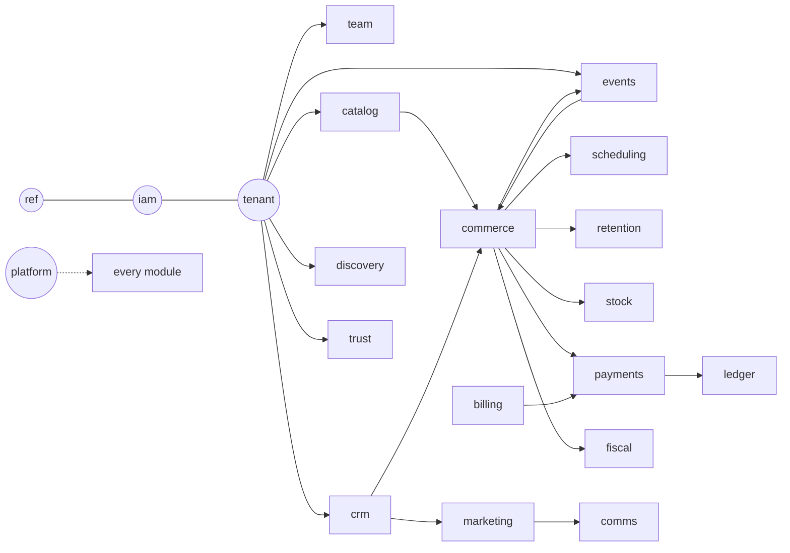

# 05 — Data model

**Status:** v2 baseline: 266 tables in 20 schemas, PostgreSQL 17+/18 with PostGIS. **Source of truth:** [`db/migration/`](../db/migration/). This document explains it; when they disagree, the SQL wins and this document is wrong.

## 1. How to run and verify it

```bash
db/scripts/validate.sh --docker   # (npm run db:validate) throwaway PostGIS container → migrations → tests → race test
db/scripts/validate.sh            # same against a local server / PG* env vars
KEEP_DB=1 db/scripts/validate.sh  # local mode: keep the database for inspection
```

`validate.sh` applies every migration in Flyway order, each in its own transaction, then runs:

| Suite | Proves |
|---|---|
| `db/tests/01_core_invariants.sql` | UUIDv7 format/order; staff and resource double-booking rejected (incl. a class instructor vs a calendar block, i.e. across verticals); back-to-back allowed; released rows don't block; cross-tenant FK substitution rejected; ticket bucket oversell rejected; confirm/release lifecycle; no return beyond sold; movements immutable; no double ticket issuance; order-line arithmetic; typed line references; order header = sum of lines |
| `db/tests/02_money_invariants.sql` | One successful attempt per intent (+ `SUCCEEDED_DUPLICATE`); provider reference unique; capture syncs the order; refund cap; requested refunds don't consume the cap; succeeded refunds immutable and synced; ledger balanced per transaction; no cross-currency netting; ledger immutable; balances maintained; gift card never negative and depletes at zero |
| `db/tests/03_tenant_isolation.sql` | Run as `beavent_app`: no context sees nothing; org A sees only A; writes into B rejected; cross-tenant updates touch 0 rows; system role templates immutable; no access to credentials, sessions or raw webhooks; inventory counters and the marketplace read model are not writable; consumer sees own customer records and orders across orgs only |
| `db/tests/04_schema_lint.sql` | Conventions for every current **and future** migration: every `org_id` table has RLS (or is on the documented exempt list); the app cannot update/delete RLS-less tables; no floating point; all `*_minor` are `bigint` and have a currency; every `updated_at` has its trigger; only `timestamptz`; every table has a primary key |
| `db/scripts/concurrency_check.sh` | 40 parallel sessions race for 5 tickets → exactly 5 reservations; 40 overlapping bookings of one stylist → exactly 1 accepted |

On a server without PostGIS, the script shims `geography(Point,4326)` to `point` so everything else can still be validated. `--docker` and CI always use real PostGIS (`postgis/postgis:17-3.5`). The backend's integration test also applies the same migrations through Flyway on PostGIS.

## 2. Conventions

| Topic | Rule |
|---|---|
| Keys | `id uuid DEFAULT platform.uuid_v7()` (time-ordered). Code-keyed reference tables use their natural code (`ref.currencies.code`). |
| Tenancy | Every tenant-owned row has `org_id`. Parents declare `UNIQUE (org_id, id)`; children reference `(org_id, parent_id)`. Because FK checks bypass RLS, the composite key is what makes cross-tenant references impossible. |
| Money | `*_minor bigint` + `currency_code char(3)` → `ref.currencies` (minor units 0–4). Some child tables (`order_line_taxes`, `refund_lines`, `invoice_lines` …) inherit the currency of their parent. The lint test lists them explicitly. |
| Time | `timestamptz` for instants; IANA zone stored on the location/occurrence/appointment; ranges are half-open `tstzrange` `[start, end)`. |
| Status | `text` + `CHECK (... IN ...)`. Readable in SQL, evolvable with a migration. |
| Immutable data | Ledgers, movements, histories, scans and snapshots have a `platform.reject_mutation()` trigger (SQLSTATE 23001) and no UPDATE/DELETE grant. |
| Counters | Balances and stock/inventory counters are updated only by triggers on their movement ledgers, and guarded by CHECKs. |
| Polymorphism | None via `type + id`. Use typed nullable FKs + `CHECK (num_nonnulls(...) = 1)` (e.g. `schedule_reservations`, `order_lines`, `gallery_items`). |
| Presentation content | Validated JSONB (`events.events.content`, `*_i18n`), never transactional facts. |
| Secrets | Never stored. `*_secret_ref` points to the secret manager; display values are masked. |
| Naming | Plural snake_case tables; `*_at` instants, `*_on` dates, `*_minor` money, `*_i18n` localized JSON, `*_bps` basis points. |
| `updated_at` | Maintained by the `touch_updated_at` trigger, attached by V1_99 (new tables: attach in the same migration). |

## 3. Schema map



Migration order follows dependencies: `00 foundation · 01 ref · 02 iam · 03 tenant · 04 team · 05 catalog · 06 crm · 07 events · 08 commerce · 09 scheduling · 10 ticketing · 11 retention · 12 payments · 13 ledger · 14 billing · 15 team pay · 16 stock · 17 marketing · 18 comms · 19 discovery+trust · 20 fiscal+platform ops · 21 seed · 90 security · 99 finalize`. Late foreign keys (e.g. CRM → appointments) are added with `ALTER TABLE` in the migration that creates the target.

## 4. Table dictionary

### platform: infrastructure (17)
| Table | Purpose |
|---|---|
| `files` | Metadata for every stored object; `PUBLIC`/`PRIVATE`/`SENSITIVE` visibility; virus-scan status; owned by an org or a user |
| `outbox` | Domain events written in the same transaction as the change; published to RabbitMQ after commit |
| `processed_messages` | Consumer idempotency `(consumer, message_id)` |
| `idempotency_keys` | API `Idempotency-Key` store with request hash and cached response |
| `audit_log` | Append-only record of privileged and sensitive actions, incl. impersonation |
| `feature_flags`, `feature_flag_overrides` | Rollout flags with market/org/user overrides |
| `settings` | Platform key/value settings |
| `api_clients` | Organization API keys (hashed) with scopes |
| `webhook_endpoints`, `webhook_deliveries` | Outbound partner webhooks and delivery attempts |
| `integrations` | Google Reserve, Meta, Zoom, pixels, accounting exports … |
| `data_exports` | Async exports (customers, sales, attendees, journals) |
| `data_subject_requests` | Privacy rights requests with due dates |
| `support_cases`, `support_messages` | Support desk for consumers and partners (internal notes hidden from requesters by RLS) |
| `cms_entries` | Marketplace content per market and language |

### ref: reference and markets (16)
| Table | Purpose |
|---|---|
| `currencies` | ISO 4217, minor units, cash rounding |
| `languages` | BCP 47, script, direction (RTL ready) |
| `countries`, `country_languages` | Geography and conventions (calendar, local-time convention, address format) |
| `administrative_areas` | Country-configured hierarchy as `ltree` paths (ET: region → sub-city/zone → woreda → kebele) |
| `public_holidays` | Per country/area; lunar dates flagged `is_estimated` |
| `fx_rates` | Rate observations used only as snapshots (presentment) |
| `markets`, `market_currencies`, `market_languages`, `market_features` | Commercial activation per country, with what can be priced/settled/presented and which features are on |
| `categories` | One taxonomy for businesses, services, events and products |
| `tax_categories`, `tax_rates` | Effective-dated rates per country × tax × category × seller regime; overlap excluded; `is_verified` |
| `legal_documents`, `legal_document_versions` | Terms, privacy, merchant agreement per market and language |

### iam: identity and access (14)
| Table | Purpose |
|---|---|
| `users` | One account per person; phone-first; status incl. `MERGED`; calendar preference |
| `user_profiles`, `user_addresses` | Display profile; saved addresses (landmark + geo) |
| `user_credentials` | Argon2id hash, lockout |
| `user_identities` | Google / Apple / Telegram / Fayda links |
| `devices` | App installations and push tokens |
| `sessions` | Refresh-token rotation families with reuse detection |
| `auth_challenges` | OTP and verification challenges (destination stored as HMAC) |
| `user_consents` | Acceptance of legal document versions |
| `permissions` | One permission catalogue (`ORGANIZATION` and `PLATFORM` scopes; `is_sensitive` → step-up code) |
| `staff_roles`, `staff_role_permissions`, `user_staff_roles` | Platform staff roles, scoped per market |

### tenant: organizations (14)
| Table | Purpose |
|---|---|
| `organizations` | The single tenant root: kind, home market, verification, marketplace status |
| `organization_capabilities` | APPOINTMENTS, CLASSES, EVENTS, RESERVED_SEATING, RETAIL, AT_HOME_SERVICES, MEMBERSHIPS … |
| `legal_entities` | Seller of record per country: TIN, VAT, tax regime, functional currency |
| `places` | Physical/virtual places; public venues shared across organizers (`owner_org_id` NULL), mergeable |
| `locations`, `location_hours`, `location_closures` | Where an org operates; hours and closures |
| `service_areas` | At-home coverage (admin area or radius) with travel fee and time |
| `custom_domains` | Mini-site domains |
| `roles`, `role_permissions` | System templates (`org_id` NULL) + custom org roles |
| `members`, `member_locations`, `invitations` | Membership, location scope, invitations |

### team (16)
| Table | Purpose |
|---|---|
| `pricing_levels` | Junior/Senior/Master price tiers |
| `staff`, `staff_locations` | Bookable people (login optional); employment type incl. chair renter; languages spoken |
| `working_patterns` | Weekly (or N-weekly) patterns, effective-dated |
| `shifts` | Concrete shifts (no overlapping published shifts) |
| `time_off` | Leave requests and approvals |
| `time_entries` | Clock-in/out (no overlaps) |
| `compensation` | Wage basis, effective-dated without overlap |
| `targets` | Staff/location targets |
| `tip_allocations` | Tip splits per staff |
| `commission_rules`, `commission_entries` | Rules; append-style earned/reversed entries (earned once per line and staff) |
| `pay_runs`, `pay_run_items`, `pay_run_adjustments`, `pay_run_payments` | Earnings periods (no overlap per legal entity); net = wages + commission + tips + adjustments − deductions (CHECK) |

### catalog (22)
| Table | Purpose |
|---|---|
| `resources` | Rooms/chairs/beds/equipment with parallel units |
| `service_groups`, `services` | Menu sections; services (delivery modes, audience, patch-test rule, tax category) |
| `service_variants`, `service_variant_stages` | Bookable options; optional stage template (staff free during processing) |
| `service_prices` | Price/duration overrides by location/staff/level, effective-dated, overlap excluded |
| `location_services`, `staff_services` | Where and by whom a service is offered |
| `service_resource_requirements` | Specific resource or "any of kind" per variant/stage |
| `addons`, `service_addons` | Add-ons and where they apply |
| `bundles`, `bundle_items` | Several services/products booked and priced together |
| `products`, `product_variants`, `product_location_prices` | Retail/professional products; SKU and barcode unique per org |
| `gift_card_programs` | Gift card definitions (amounts, validity, redeemable on) |
| `membership_plans`, `membership_benefits` | One-time or recurring memberships; credits, discounts, priority, event access |
| `package_plans`, `package_plan_items` | Prepaid packages |
| `gallery_items` | Images for locations/services/products/staff/events (typed FKs) |

### crm (13)
| Table | Purpose |
|---|---|
| `customers` | The org's record of a person (linked to `iam.users` when known); marketplace acquisition timestamp; merge/erase |
| `customer_addresses`, `customer_notes`, `tags`, `customer_tags` | Addresses, notes/alerts/allergies, tags |
| `customer_files` | Before/after photos and documents (SENSITIVE files) |
| `treatment_records`, `patch_tests` | Colour formulas, body charts; patch tests with validity |
| `customer_consents` | Append-only consent evidence per purpose/channel |
| `forms`, `form_versions`, `form_assignments`, `form_submissions` | One forms engine: consultation/intake/consent **and** event order/attendee questions |

### events (25)
| Table | Purpose |
|---|---|
| `events`, `event_translations`, `event_tags`, `event_cohosts` | Event aggregate (kind incl. TIMED_ENTRY, MULTI_DAY, CLASS_SERIES), translations, tags, co-hosts |
| `recurrence_rules`, `occurrences`, `online_access`, `sessions` | RRULE generation; dated instances/time slots; join links revealed to holders only; sessions with capacity |
| `ticket_types`, `ticket_type_occurrences`, `price_phases` | Paid/free/donation/PWYW; visibility incl. access-code-only; passes; admissions per unit; sequential release; early-bird phases |
| `inventory_buckets`, `pool_ticket_types` | Capacity constraints (occurrence/type/pool/session) with `sold + reserved + held ≤ capacity` |
| `inventory_movements` | Append-only RESERVE/RELEASE/CONFIRM/SELL/RETURN/HOLD/UNHOLD/HOLD_SELL; trigger maintains buckets and enforces lifecycle |
| `inventory_holds` | Organizer holds |
| `seat_maps`, `seat_map_versions`, `seats`, `occurrence_seats` | Versioned layouts; per-occurrence seat state (unique per seat) |
| `staff_assignments` | Event-scoped staff (check-in, box office) |
| `tickets`, `ticket_transfers` | One credential per admission (hash only; rotated on transfer); unique per line/unit/admission |
| `checkin_devices`, `scans`, `admissions` | Scoped devices with offline manifests; idempotent scan log; authoritative admission state |

### commerce (19)
| Table | Purpose |
|---|---|
| `orders` | One seller, one currency, any mix of lines; status + payment status; expiry for pending orders; deferred total check |
| `order_lines`, `order_line_taxes`, `order_status_history` | Typed lines with arithmetic CHECK; immutable tax snapshots; status history |
| `payment_schedule` | Full / deposit / balance / instalments, online or at venue |
| `promotions`, `promotion_targets`, `promo_codes`, `promo_code_unlocks`, `redemptions` | Discounts (incl. platform-funded, off-peak windows), discount and access codes, usage |
| `document_sequences` | Gapless numbering per legal entity and document type (`commerce.next_document_number`) |
| `invoices`, `invoice_lines`, `receipts` | Quotes, invoices, credit notes; receipts |
| `cash_drawers`, `cash_drawer_sessions`, `cash_movements` | Front desk and box office cash (one open session per drawer; append-only movements) |
| `waitlist_entries`, `waitlist_offers` | One waitlist for occurrences and appointment windows |

### scheduling (13)
| Table | Purpose |
|---|---|
| `booking_policies` | Notice, horizon, interval, approval, deposit, cancellation and no-show terms (most specific wins) |
| `appointment_groups`, `appointment_series` | Group bookings; recurring appointments |
| `appointments`, `appointment_items`, `appointment_item_addons`, `appointment_item_stages`, `appointment_item_resources`, `appointment_status_history` | The booking, its services, add-ons, stages, resources, history; policy snapshot |
| `holds` | Checkout holds with expiry |
| `calendar_blocks` | Breaks, meetings, time off, maintenance |
| `occurrence_assignments` | Instructors/rooms for event or class occurrences |
| `schedule_reservations` | **The** staff/resource ledger: GiST exclusion on staff and on resource unit; exactly one source |

### retention (12)
| Table | Purpose |
|---|---|
| `gift_cards`, `gift_card_entries` | Hashed codes; ledgered balance ≥ 0 |
| `customer_balances`, `customer_balance_entries` | Store credit per customer and currency |
| `customer_memberships` | Membership lifecycle and renewal method |
| `entitlements`, `entitlement_usages` | Countable rights from packages/memberships; used ≤ total |
| `loyalty_programs`, `loyalty_tiers`, `loyalty_rewards`, `loyalty_accounts`, `loyalty_entries` | Points programme with ledgered balances |

### stock (10)
`suppliers`, `levels` (cache; on hand ≥ 0, reserved ≤ on hand), `movements` (append-only, signed by kind, trigger-maintained levels), `purchase_orders`, `purchase_order_lines`, `transfers`, `stocktakes`, `stocktake_lines`, `delivery_zones`, `fulfilments` (pickup at location or event, local delivery, courier).

### payments (18)
See [doc 04](04-payments-and-money.md). `providers`, `methods`, `provider_capabilities` (LIVE requires `verified_at`), `provider_accounts` (platform or org owned; sub-accounts), `routes`, `org_settings` (collection mode, payout schedule), `payment_intents`, `payment_attempts` (one success per intent; manual verification rules), `instruments`, `webhook_events` (deduplicated inbox), `payment_links`, `payout_accounts` (cooling-off), `payouts` (approval rule), `refunds` (cap trigger; immutable once succeeded), `refund_lines`, `disputes`, `provider_statements`, `statement_lines`.

### ledger (5)
`accounts`, `transactions` (immutable; reversal at most once), `entries` (immutable; currency must match account; balanced per currency at commit), `balances` (trigger-maintained), `scheduled_releases`.

### billing (10)
`plans`, `plan_prices` (no overlap per plan × market × currency × interval), `plan_entitlements`, `subscriptions` (one live per org), `subscription_addons`, `fee_rules` (no overlap per scope), `fee_assessments` (immutable fee record; new-client commission once per order), `usage_records` (idempotent per meter and source), `invoices`, `invoice_lines`.

### fiscal (3)
`schemes` (ET MoR, KE eTIMS, UG EFRIS, TZ VFD, RW EBM), `registrations` (per legal entity/location/device), `documents` (submission per order/invoice/refund; accepted requires authority number).

### marketing (13)
`segments`, `segment_members`, `campaigns`, `campaign_recipients` (consent-checked, one per destination), `automations`, `automation_steps`, `automation_runs` (deduplicated per trigger), `referral_programs`, `referrals`, `tracking_links`, `tracking_link_daily`, `ad_campaigns` (spend ≤ budget), `ad_daily_stats`.

### comms (13)
`provider_accounts` (SMS/WhatsApp/Telegram/email/push), `templates` (platform defaults + org overrides, per language and version), `notifications` (dedupe key, scheduled send), `deliveries` (per channel; cost), `preferences`, `suppressions` (STOP, bounces), `conversations`, `participants`, `messages` (bridged channels), `ai_agents`, `ai_knowledge`, `ai_sessions`, `ai_actions` (append-only).

### discovery (7)
`listings` (public read model for locations and events; written only by the projector; carries `search_text` for trigram matches and, in `attributes`, the hours and bookable dates the filters use, V8_01), `reviews` (verified only, one per visit/order), `follows`, `saved_items`, `collections`, `collection_items`, `search_events`.

### trust (6)
`verification_cases` (KYB/KYC/payout account/event review; MANUAL, FAYDA, SMILE_ID, BANK_NAME_ENQUIRY), `verification_documents`, `risk_profiles` (payout delay, reserve, pre-event payout share, manual review), `content_reports`, `moderation_actions` (append-only), `fraud_signals`.

## 5. Security model in the database

| Role | Used by | Access |
|---|---|---|
| `beavent_app` | API request handling | DML on tenant schemas **through RLS**; read-only reference/catalogue tables; insert-only outbox/audit; no credentials, sessions, challenges, MFA, raw webhooks, statements or trust internals; cannot write inventory counters, stock levels or the marketplace read model |
| `beavent_identity` | Identity module | All of `iam`; reference reads; notification writes for OTP |
| `beavent_system` | Workers, admin backend | Everything, `BYPASSRLS`; every admin action audited in the application |
| `beavent_readonly` | BI on a replica | `SELECT` on non-PII schemas, cross-tenant |

RLS contexts (set by `platform.set_request_context(user_id, org_id)`, transaction-local):

* **Partner workspace**: `org_id` set after a membership/permission check. Policy `org_id = current_org_id()` on every org-owned table (generated by `platform.apply_tenant_rls`).
* **Consumer**: only `user_id` set. Permissive self-access policies on `crm.customers`, `commerce.orders`/`order_lines`, `events.tickets`/`ticket_transfers`, `scheduling.appointments`/`appointment_items`, `payments.payment_intents`/`instruments`, `iam.users`/`user_profiles`/`user_addresses`/`devices`, `discovery.*`, `comms.notifications`/conversations as participant.
* **Checkout / public pages of org X**: `org_id = X` in a dedicated (read-only for pages) transaction.
* **Shared reference rows** (system role templates, platform promotions, platform provider accounts/routes, market fee rules, platform templates) are readable by every tenant but writable by none.

Policies call `platform.current_org_id()` through `(SELECT ...)`, so it is evaluated once per statement, not once per row.

## 6. Invariants and where they are enforced

| Invariant | Enforcement | Test |
|---|---|---|
| No staff/resource double-booking (appointments, holds, blocks, classes) | GiST exclusion on `schedule_reservations` | 01, race |
| No ticket oversell across type, occurrence, pool, session | Bucket CHECK + trigger-only counters | 01, race |
| A reservation is released or confirmed once, never both | Unique index + trigger lifecycle | 01 |
| One ticket per paid unit/admission | `UNIQUE (order_line_id, unit_index, admission_index)` | 01 |
| One admission per ticket per occurrence/session | `UNIQUE NULLS NOT DISTINCT` on `admissions` | — (constraint) |
| Seat sold once per occurrence | `UNIQUE (occurrence_id, seat_id)` + valid-ticket seat index | — (constraint) |
| Line arithmetic and header = Σ lines, single currency | CHECKs + deferred constraint trigger | 01 |
| One successful attempt per intent | Partial unique index | 02 |
| Refunds ≤ captured; succeeded refunds final | `guard_refund_total`, `apply_refund_success` | 02 |
| Ledger balanced per currency, immutable | Deferred trigger + mutation triggers | 02 |
| Stored value never negative | Trigger-maintained balances with CHECK | 02 |
| Stock never negative | `stock.levels` CHECK via movement trigger | — (constraint) |
| Tenant isolation | Composite FKs + RLS + grants | 01, 03, 04 |
| Payout account cooling-off; payout approval | Column default + CHECK | — (constraint) |
| Provider capability `LIVE` only when verified | CHECK | — (constraint) |
| Non-overlapping tax rates, fee rules, plan prices, service prices, compensation, shifts, pay runs | Exclusion constraints | — (constraint) |

## 7. Migration practice

* This baseline becomes Flyway `V1_xx`. Never edit a released migration; add `V2_...`.
* Every new org-owned table must: carry `org_id`, declare `UNIQUE (org_id, id)` if referenced, use composite FKs, call `SELECT platform.apply_tenant_rls('schema.table'::regclass)`, attach `touch_updated_at` if it has `updated_at`, and receive explicit grants. `04_schema_lint.sql` fails CI otherwise.
* Expand-and-contract for breaking changes (add column → backfill → switch reads → drop).
* High-volume tables to partition by month once volume warrants it: `events.scans`, `discovery.search_events`, `comms.deliveries`, `platform.outbox` (after publish), `platform.audit_log`, `ledger.entries` (by year).
* PostgreSQL 18 adds native `uuidv7()`. `platform.uuid_v7()` can then become a thin wrapper.
